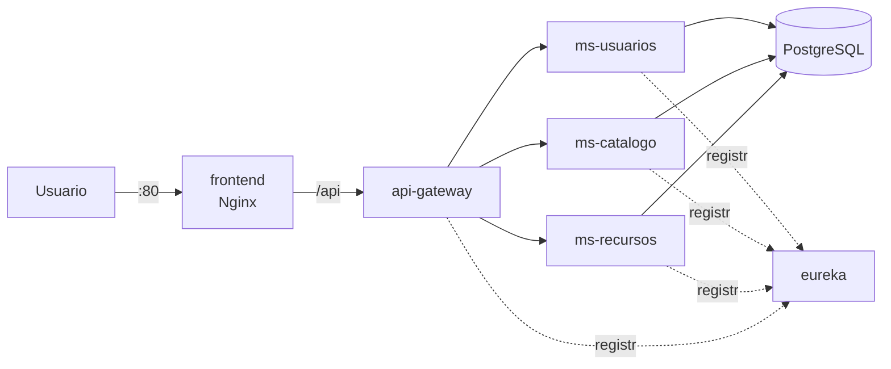

# Biblioteca Spring Boot 📚

[](https://github.com/lBlackDevDUOC/biblioteca-springboot-devops/actions/workflows/ci-cd.yml)
[](https://sonarcloud.io/summary/new_code?id=lBlackDevDUOC_biblioteca-springboot-devops)

Sistema de biblioteca construido con una **arquitectura de microservicios en Spring Boot**: usuarios, catálogo de libros y recursos físicos, con un API Gateway, descubrimiento de servicios con Eureka, PostgreSQL y una vista web.

Lo uso para la **Evaluación Parcial 2 de Ingeniería DevOps (DOY0101)**. El foco está en automatizar todo el ciclo de vida del proyecto: cada cambio pasa por análisis de seguridad, pruebas unitarias con cobertura, análisis de calidad, construcción de imágenes Docker y despliegue automático en AWS EC2.

## Arquitectura

| Servicio | Función | Puerto |
| --- | --- | ---: |
| `frontend` | Nginx: vista web y proxy hacia el API Gateway | 80 |
| `api-gateway` | Punto de entrada único a los microservicios | 9000 |
| `eureka` | Descubrimiento de servicios | 8761 |
| `ms-usuarios` | Usuarios y autenticación con JWT | 9001 |
| `ms-catalogo` | Catálogo de libros y categorías | 9002 |
| `ms-recursos` | Recursos físicos (libros, notebooks, tablets…) | 9003 |
| `postgres` | PostgreSQL 16, una base de datos por microservicio | 5432 (interno) |
| `common` | Librería compartida: seguridad JWT y manejo de errores | — |



Todos los servicios corren como contenedores en una sola instancia EC2, orquestados con Docker Compose. Solo el puerto 80 (y opcionalmente 8761 para ver Eureka) queda expuesto a Internet; PostgreSQL y los microservicios se comunican por la red interna de Docker.

## Flujo CI/CD

```text
dev ──► Pull Request ──► main ──► GitHub Actions ──► AWS EC2
```

El pipeline está en [`.github/workflows/ci-cd.yml`](.github/workflows/ci-cd.yml) y sigue este orden:

| # | Etapa | Qué hace | Si falla… |
| --- | --- | --- | --- |
| 1 | **Snyk** | Busca vulnerabilidades en las dependencias Maven de todos los módulos | Se detiene con cualquier vulnerabilidad alta o crítica |
| 2 | **Pruebas + JaCoCo** | Ejecuta las pruebas JUnit 5 + Mockito y genera la cobertura (XML y HTML) | Se detiene si una prueba falla o un servicio baja del 80 % de cobertura |
| 3 | **SonarCloud** | Analiza bugs, vulnerabilidades, code smells y cobertura | Se detiene si no se cumple el Quality Gate |
| 4 | **Docker multistage** | Valida el `docker-compose.yml` y construye las imágenes | Se detiene si alguna imagen no compila |
| 5 | **Deploy EC2** | Copia el proyecto por SSH a la EC2 y ejecuta `docker compose up -d` | Muestra `docker compose logs` y `ps` para diagnosticar |

Cuándo corre cada etapa:

| Evento | Etapas |
| --- | --- |
| Push a `dev` | 1 → 2 → 4 |
| Pull Request de `dev` a `main` | 1 → 2 → 3 → 4 |
| Push (merge) a `main` | 1 → 2 → 3 → 4 → 5 |

SonarCloud corre en los Pull Requests y en `main` porque el plan gratuito solo analiza la rama principal y los PR. Los cambios igual se revisan antes de llegar a `main`, porque el Quality Gate del PR bloquea el merge.

## Pruebas y cobertura

Las pruebas están en `src/test` de cada microservicio y usan **JUnit 5 + Mockito** para aislar la lógica de negocio de la base de datos y de los otros servicios:

| Clase de prueba | Qué cubre | Cobertura del servicio |
| --- | --- | --- |
| `LibroServiceTest` | CRUD de libros, ISBN único, categorías, sincronización con ms-recursos | 100 % |
| `AuthServiceTest` | Login con JWT, cuentas inactivas, bloqueo tras 5 intentos fallidos, registro con BCrypt | 100 % |
| `UsuarioServiceTest` | CRUD de usuarios, email único, activar y desactivar | 97 % |
| `RecursoFisicoServiceTest` | SKU único, ISBN validado contra el catálogo, integridad referencial | 100 % |
| `LibroProyeccionServiceTest` | Copia local de libros e integridad referencial | 100 % |
| `*ApplicationTests` | Que el contexto de Spring levante en cada microservicio | — |

En total son **71 pruebas**. Para que corran sin PostgreSQL ni Eureka, cada microservicio tiene un perfil de pruebas (`src/test/resources/application-test.yml`) con H2 en memoria.

**Política de calidad**, aplicada por **JaCoCo** en el `pom.xml` padre:

- Todas las pruebas deben pasar.
- Cada clase de la capa de servicios (`*.service.*`) debe tener al menos **80 % de cobertura de líneas**.
- Quedan fuera del cálculo las clases sin lógica: DTO, entidades, mappers, configuración, clientes Feign y las clases `*Application`.

Para correrlas en local (Java 21 y Maven 3.9):

```bash
mvn verify
```

Los reportes quedan en `<modulo>/target/site/jacoco/index.html` y en el pipeline se descargan como artefacto `reportes-pruebas-jacoco`.

## Seguridad

- **Snyk** revisa las dependencias de todos los módulos en cada ejecución del pipeline y bloquea con severidad alta o crítica.
- **Dependabot** ([`.github/dependabot.yml`](.github/dependabot.yml)) revisa cada semana Maven, las imágenes Docker y las GitHub Actions, y abre PR hacia `dev`.
- **SonarCloud** analiza el código y bloquea con el Quality Gate.
- **Dependencias parchadas:** el `pom.xml` padre fija versiones corregidas de librerías transitivas vulnerables (Tomcat, Netty, Jackson, Spring Cloud Gateway, PostgreSQL, BouncyCastle y las de Eureka).
- **Excepciones documentadas:** [`.snyk`](.snyk) solo ignora una vulnerabilidad de Spring Framework sin parche para la versión 6.2 y que no aplica al proyecto (vistas XSLT), con justificación y fecha de vencimiento.
- **Sin credenciales en el código:** la contraseña de PostgreSQL y la clave JWT se leen de variables de entorno (`DB_PASSWORD`, `JWT_SECRET`). En la EC2 el pipeline las escribe en un `.env` a partir de los GitHub Secrets.
- **Contenedores sin root:** los servicios Java corren con el usuario `biblioteca` (uid 1001).

## Trazabilidad

Cada cambio se puede seguir desde el código hasta el servidor:

1. **Commit en `dev`** con mensajes del tipo `feat:`, `fix:`, `test:`, `ci:`… (ver [CONTRIBUTING.md](CONTRIBUTING.md)).
2. **Pull Request a `main`** con los resultados de Snyk, pruebas, SonarCloud y Docker visibles en el PR.
3. **Ejecución del pipeline** identificada por commit, autor y rama, con el resumen de cobertura por servicio y los reportes descargables.
4. **Deploy en el entorno `production`** de GitHub: queda registrado qué commit se desplegó y cuándo.
5. **Verificación final** del pipeline contra la IP pública de la EC2 (frontend y API Gateway en `UP`).

## Levantar el proyecto en local

Requisitos: Docker Desktop con al menos 4 GB de RAM asignados.

```bash
cp .env.example .env      # edita POSTGRES_PASSWORD y JWT_SECRET
docker compose up -d --build --wait
```

- Frontend: <http://localhost/>
- Eureka: <http://localhost:8761/>
- Estado del Gateway: <http://localhost/gateway-health>

Usuario de prueba de los datos iniciales: `ana@administrador.cl` / `Biblio@2026` (login en `POST /api/v1/auth/login`). Las colecciones de Postman están en [`postman/`](postman).

```bash
docker compose ps          # estado de los servicios
docker compose logs -f     # logs en vivo
docker compose down        # detener conservando los datos
docker compose down -v     # detener y borrar la base de datos
```

## Despliegue en AWS EC2

**Instancia:** Amazon Linux 2023, **t3.medium** recomendada (mínimo t3.small: 2 GB de RAM + el swap que crea el script), con IP elástica para que la dirección no cambie entre sesiones del Learner Lab.

**Security Group:** puerto 22 (SSH, para GitHub Actions) y 80 (HTTP). El 8761 es opcional, para ver Eureka.

**User Data:** el contenido de [`deploy/ec2-user-data.sh`](deploy/ec2-user-data.sh). Instala Docker, Docker Compose, Buildx y 2 GB de swap, y deja el marcador `/opt/biblioteca/.bootstrap-ready` que el pipeline espera antes de desplegar.

**GitHub Secrets** (Settings → Secrets and variables → Actions):

| Secret | Uso |
| --- | --- |
| `SNYK_TOKEN` | Token de la cuenta de Snyk |
| `SONAR_TOKEN` | Token de SonarCloud |
| `AWS_HOST` | IP elástica de la EC2 |
| `AWS_USER` | Usuario SSH (`ec2-user` en Amazon Linux) |
| `AWS_SSH_KEY` | Contenido completo de la clave privada `.pem` |
| `POSTGRES_PASSWORD` | Contraseña de PostgreSQL en la EC2 |
| `JWT_SECRET` | Clave JWT en Base64 (`openssl rand -base64 48`) |

> Nunca subas al repositorio archivos `.pem`, `.env`, contraseñas ni tokens.

Después de un deploy correcto la aplicación queda en `http://<IP-ELASTICA>/`.

## Estado del proyecto

**Hecho:**

- [x] Repositorio con ramas `main` y `dev`.
- [x] Perfil de pruebas con H2: las pruebas de contexto ya no dependen de PostgreSQL.
- [x] Pruebas unitarias JUnit 5 + Mockito para todos los servicios (71 pruebas).
- [x] JaCoCo con reporte XML/HTML y mínimo de 80 % en servicios.
- [x] Pipeline encadenado: Snyk → Pruebas → SonarCloud → Docker → Deploy EC2.
- [x] Dependabot para Maven, Docker y GitHub Actions.
- [x] Dependencias vulnerables actualizadas y política `.snyk` documentada.
- [x] Credenciales fuera del código (variables de entorno y GitHub Secrets).
- [x] Imagen Java sin root; User Data de EC2 con Buildx y swap.
- [x] Corrección del esquema SQL (`BIGSERIAL`/`BIGINT`): con el perfil `prod` los microservicios no arrancaban porque las tablas usaban `SERIAL` y las entidades `Long`.
- [x] Stack completo probado en local: 7 contenedores `healthy`, login JWT y consultas a los 3 microservicios.

**Pendiente (configuración en las cuentas):**

- [ ] Importar el repositorio en SonarCloud y desactivar *Automatic Analysis*.
- [ ] Activar Dependabot alerts y security updates en *Settings → Code security*.
- [ ] Crear la EC2 con IP elástica y User Data.
- [ ] Cargar los GitHub Secrets.
- [ ] Merge del Pull Request `dev` → `main` para el primer despliegue en EC2.

## Documentación del repositorio

- [CONTRIBUTING.md](CONTRIBUTING.md): flujo de ramas y commits.
- [CHANGELOG.md](CHANGELOG.md): historial de versiones.
- [CODE_OF_CONDUCT.md](CODE_OF_CONDUCT.md): normas de convivencia.
- [LICENSE.md](LICENSE.md): condiciones de uso.
